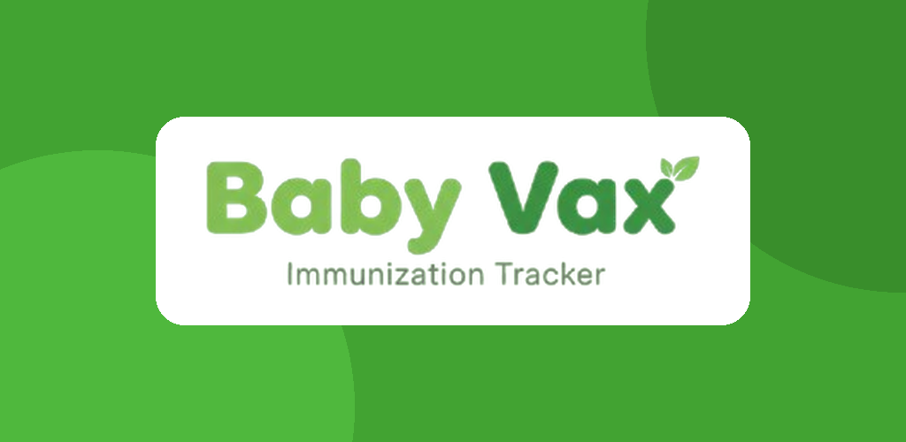

<p align="center">
  
</p>

# Baby Vax

**A child vaccination tracker for parents, built with Flutter and Firebase.**

Enter a child's date of birth once, and Baby Vax builds the full routine immunization schedule, from birth to the teenage boosters. It reminds you the evening before each appointment and again that morning. The reminders are scheduled on the phone itself, so they arrive on time with no internet connection.

Baby Vax started as my graduation project for the BSc in Applied Information Technology at Al-Aqsa University in Gaza, Palestine (graded 93%). I have kept developing it since then, toward a public release on Google Play.

> Baby Vax is an organising tool, not medical advice. Its schedule follows the Palestinian Ministry of Health routine childhood immunization schedule, which is based on the WHO Expanded Programme on Immunization (EPI). Parents should always follow their own doctor and their country's national schedule.

---

## Features

- **Personal schedule:** the full vaccination schedule is generated from the child's birth date.
- **Offline reminders:** one reminder the evening before each appointment and one on the morning of the day. They arrive even when the app is closed and the phone is offline.
- **Progress tracking:** mark each dose as completed and see what is still due. The next vaccination appears as soon as you open the app.
- **Growth tracking:** record height, weight, head circumference and haemoglobin level.
- **Health tips** for each stage of the child's development.
- **Arabic and English,** with a full right-to-left layout for Arabic.
- **Light and dark themes.**
- **Privacy:** each family's data is readable only by its owner. You can delete your account and all of its data from inside the app.

## Tech stack

| Area | Tools |
|---|---|
| App | Flutter, Dart |
| State, routing and dependency injection | GetX, with one module per screen (binding, controller, view) |
| Backend | Firebase Authentication, Cloud Firestore, Firebase App Check |
| Reminders | `flutter_local_notifications` with `timezone`: scheduled on the device, no server needed |
| Local storage | `get_storage` |
| Monitoring | Firebase Crashlytics |
| Testing | `flutter_test`, plus Firestore security-rule tests on the Firebase emulator (Node.js) |
| CI | GitHub Actions |

## Engineering highlights

- **Correct date arithmetic.** Vaccine dates are calculated in calendar months, not fixed day counts. The first version used day counts, and they drifted: the 12-month dose landed about two weeks early, the 5-, 11- and 15-year doses came one to four days early because leap days were ignored, and daylight-saving changes could move a reminder to another day. Unit tests now cover these cases.
- **Reminders without a server.** The app schedules its reminders locally instead of sending push notifications from the cloud. This keeps them working offline and lets the app run on Firebase's free plan.
- **Secure by default.** Firestore rules allow each user to read and write only their own data, validate the fields on every write, and deny everything else. 35 automated tests check the rules against the Firestore emulator.
- **Tested and checked on every change.** The app has more than 150 unit and widget tests. On every push, CI checks the formatting, runs static analysis with warnings treated as errors, runs all the tests, and builds a release version of the Android app.

## Project structure

```
lib/
├── main.dart
└── app/
    ├── config/      # Theme, constants, session
    ├── core/
    │   ├── notification/   # Reminders, split into domain, data and application layers
    │   ├── service/        # Schedule generator, Firestore access, account deletion
    │   ├── routes/         # App routes
    │   ├── values/         # Translations (ar, en), enums, storage keys
    │   └── widget/         # Shared UI components
    └── modules/     # One folder per screen: auth, home, medical_dates,
                     # medical_date_details, tips, tip_details, setting, ...
test/                # Unit and widget tests
firestore-tests/     # Security-rule tests run against the Firestore emulator
firestore.rules      # Firestore security rules
docs/                # Privacy policy, account-deletion page, store listing
```

## Running locally

Requirements: the Flutter SDK (CI uses 3.47.9) and a device or emulator.

```bash
git clone https://github.com/ahmedassr/baby_vax.git
cd baby_vax
flutter pub get
flutter run
```

The repository includes the Firebase client configuration for the app's own Firebase project. To run the app against your own project, replace it with `flutterfire configure`, then deploy `firestore.rules` and `firestore.indexes.json` to your project.

Run the tests:

```bash
flutter test                         # unit and widget tests
cd firestore-tests && npm install && npm test   # security rules (needs Node and Java)
```

## Author

**Ahmed Al Assar**, software developer in Gaza, Palestine.

[LinkedIn](https://www.linkedin.com/in/ahmed-alassar-840528259) · [GitHub](https://github.com/ahmedassr) · [Portfolio](https://ahmedalassar-portfolio.vercel.app)
